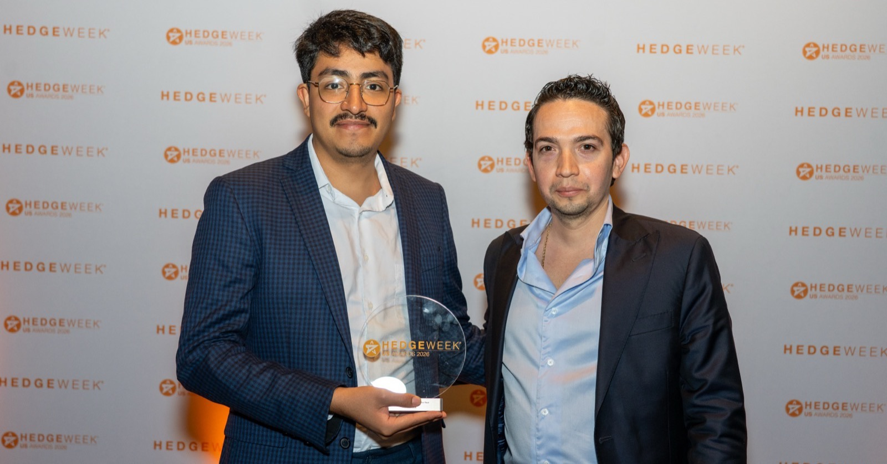

Fintela has won **New Solution Product of the Year** at the Hedgeweek® US Awards 2026. The winners were announced on October 8, 2026, at a ceremony at Convene 237 Park Avenue in New York.

In August we [shared that Fintela had been shortlisted](/blog/fintela-hedgeweek-announcement) in this category. Two months later, the team was in New York to collect the award.

## About the award

The Hedgeweek US Awards recognize fund performance and service provider excellence across the U.S. hedge fund industry. Winners are chosen by an online vote of the Hedgeweek readership from the firms shortlisted in each category. That makes this a vote by the people who run, allocate to and serve hedge funds, which is why it means so much to us.

## Skip months of infrastructure build

When a hedge fund or quant team builds its research infrastructure in house, the data pipelines, the backtesting engine and the validation tooling can take months of engineering before a single strategy is tested. Fintela provides that infrastructure from day one in a single cloud environment. Teams can spend their time on what matters most: alpha creation.

The platform's strategy-validation engine is built around **out-of-sample testing and statistical robustness**. It is there to tell a team whether a strategy's edge holds up before they allocate capital to it, not after the market has answered the question for them.

## Fintelligent: from idea to tested strategy

The platform also includes [Fintelligent](/product/agentic-ai), Fintela's AI feature. It turns a plain-language idea into real strategy code in under 60 seconds, ready to run through Fintela's full validation process, and explains the results in plain terms.

Fintelligent is **model-agnostic**. Firms can choose from today's leading AI models and work with the one that best fits their research process.

## In the founder's words

> "This award reflects a mission we believe in deeply: technology shouldn't be a privilege reserved for the largest players. Fintela was built to give all participants in the hedge fund and investment industry access to advanced intelligence and infrastructure. We're honored to help level that playing field."
>
> **Manuel Padrón**, Co-founder and CEO, Fintela

## Thank you

Thank you to the Hedgeweek readers who voted, to our clients and partners for their trust, and to the Fintela team for building the platform this award recognizes. We congratulate every firm that was shortlisted and every winner this year.

## See it for yourself

[Fintela for hedge funds](/solutions/hedge-funds) covers what changes for an institutional desk. The [documentation overview](/docs/overview) is the map of the platform. To see it with your own strategies, [book a walkthrough](/contact) or write to [hello@fintela.io](mailto:hello@fintela.io).

---

### About Fintela

Fintela ([fintela.io](https://fintela.io)) is an AI-native quantitative trading research platform for independent traders, quants and hedge funds. It combines backtesting, an AI-powered strategy-validation engine focused on out-of-sample robustness, and Fintelligent, which builds strategies from natural language. Fintela is backed by [Momento Capital](https://momentocapital.com/).

### About the Hedgeweek® US Awards

The Hedgeweek US Awards recognize fund performance and service provider excellence within the U.S. hedge fund industry. The full list of winners is available at [hedgeweek.com](https://www.hedgeweek.com).

**Media contact:** Myrna Ortiz, [hello@fintela.io](mailto:hello@fintela.io)

*\#Fintela \#HedgeweekAwards2026 \#Fintech \#QuantResearch \#HedgeFunds*
